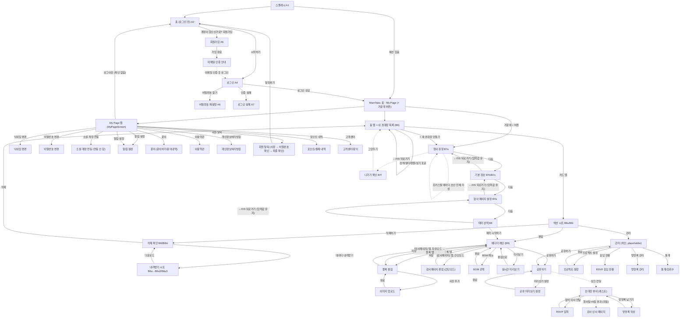

# 앱 화면 구성 (정보구조 / IA)

> `PLANNING.md`에서 논의된 기능을 바탕으로 필요한 화면을 카테고리별로 정리한 문서입니다.
> 결혼식에 국한하지 않고 모든 행사(결혼식·돌잔치·생일파티·집들이 등)의 초대장을 다루므로, 화면/용어도 "초대장"·"행사"·"게스트" 기준으로 일반화했습니다. 행사 유형별로 화면이 갈라지지는 않으며, 프로젝트 생성 시 행사 유형을 선택하고 문구는 사용자가 자유롭게 채웁니다.
>
> 디자인 핸드오프가 들어온 화면은 코드(React Native/Expo, `mobile/`)로 구현을 마쳤고 상태를 **✅ 구현됨**으로 표시합니다. 나머지는 아직 디자인 전이라 기능 명세만 있거나(B6 상세 스펙처럼) 자리만 잡아둔 상태입니다.

## A. 앱 공통 / 기본 구성 — ✅ 구현됨 (A1–A7)

> **✅ 로그인 인증 실제 구현됨**: 데이터 백엔드는 Supabase(Postgres + Auth)를 사용. 로그인 아이디는 이메일이 아니라 **사용자가 정한 아이디**이며, 이메일은 가입 인증 용도로만 쓴다 — 아이디→가입 이메일을 서버 쪽 RPC로 조회한 뒤 내부적으로 이메일/비밀번호 로그인을 수행. 아이디는 대소문자 구분 없이 DB에서 유니크(중복 가입 불가, 실시간 중복확인), 닉네임은 표시 전용이라 중복 허용. 비밀번호는 Supabase가 해시로만 저장하고 평문은 어디에도 남지 않음. 자세한 스키마는 `supabase/schema.sql` 참고.

| # | 코드 | 화면 | 설명 |
|---|---|---|---|
| 1 | A1 | 스플래시(로딩) 화면 | 앱 실행 시 첫 진입, 1.2초 후 로그인 여부에 따라 MainTabs 또는 A2로 자동 전환 |
| 2 | A2 | 홈 화면 (로그인 전) | 서비스 소개 + 블록 미리보기, `시작하기`(→ 로그인) / `계정이 없으신가요? 회원가입`(→ 회원가입) |
| 3 | ~~A3~~ | ~~홈 화면(로그인 후) 대시보드~~ | **폐기·B6에 통합됨** — 대표 프로젝트 카드 1개 + 알림 행만 보여주는 별도 대시보드는 "내 초대장 목록"(B6)과 역할이 겹쳐 제거. `MainTabs`의 "홈" 탭이 이제 바로 B6(내 초대장 목록)을 보여준다 |
| 4 | A4 | 로그인 화면 | 아이디 + 비밀번호 입력. 소셜 로그인(카카오/애플) 버튼은 UI만 있고 "준비 중" 안내만 뜸(미구현) |
| 5 | A7 | 로그인 실패 화면 | A4에서 인증 실패 시 상태. "아이디/비밀번호 불일치"와 "이메일 인증 전"을 구분해 안내 |
| 6 | A5 | 회원가입 화면 (2단계: 입력 → 이메일 인증 안내) | 아이디(로그인용, 영문·숫자·_ 4~20자, 실시간 중복확인) · 닉네임(표시용, 2~12자) · 이메일(인증용, 입력 중 `@naver.com`·`@gmail.com` 등 도메인 칩 제안) · 비밀번호 입력 → 가입 성공 시 "이메일을 확인해주세요" 안내 화면(`SignupSentScreen`)으로 이동, 재발송 가능 |
| 7 | A6 | 비밀번호 찾기/재설정 화면 (2단계) | |

## B. 제작 흐름 (로그인 후 — 프로젝트/에디터)

**진입 순서 확정**: 프로젝트 생성(B7) → 스타일 테마 선택(B8) → 에디터 메인(B9)

**탐색 구조**: 로그인 후에는 실제 하단 탭 내비게이션(`MainTabs`)으로 진입합니다. `@react-navigation/bottom-tabs` 기반의 진짜 탭 네비게이터입니다.

**✅ 탭 2개로 축소 + 가운데 버튼(변경됨)**: 기존 "홈 · 내 초대장 · 마이" 3탭 구조에서, 대시보드였던 "홈"을 없애고 **"홈 · My Page" 2탭**으로 줄였다 — "홈" 탭이 바로 B6(내 초대장 목록) 화면이다. 두 탭 사이 가운데에 다른 탭과 동일한 크기·색으로(튀지 않게) 배치된 **원형 + 버튼**이 있고, 누르면 바로 B7a(새 초대장 만들기 1단계)로 이동한다.

**프로젝트 목록 카드 구조**: 각 초대장 카드에 **[편집] [관리]** 2개 버튼이 함께 노출됨 — 에디터는 순수 콘텐츠 편집 전용, 관리는 응답/방명록/통계/프로젝트 설정 전용으로 역할 분리.

**에디터 내부는 편집 대상에 따라 2가지로 나뉨**:
- **초대장 편집**: 기존 블록 에디터로 편집
- **감사페이지 편집**: 관리 화면에서 설정한 감사페이지 모드에 따라 분기
  - 자유 모드 → 초대장과 **동일한 블록 에디터 재사용** (편집 대상만 감사페이지로 전환)
  - 간단 모드 → 고정 레이아웃의 **별도 라이트 편집 화면** (문구+사진 정도만 교체)

| # | 코드 | 화면 | 상태 | 설명 |
|---|---|---|---|---|
| 8 | B6 | 프로젝트 목록 화면 (= `MainTabs`의 "홈" 탭) | ✅ 구현됨 | 내가 만든 초대장들 목록, 검색·필터·정렬·보기 3종 지원. 카드마다 [편집]/[관리] |
| 9 | B7 | 프로젝트 생성 화면 (4단계 중 1–3) | ✅ 구현됨 | 행사 유형 → 기본 정보(호스트/일시/장소) → 감사 페이지 설정 |
| 10 | B8 | 스타일 테마 선택 화면 (4단계 중 4) | ✅ 구현됨 | 색상/폰트 기본 테마 6종 중 선택, `제작 시작하기` → B9 |
| 11 | B9 | 에디터 메인 화면 (`EditorScreen`) | ✅ 구현됨 | 실제 모습 하나로 편집. [초대장]/[감사페이지] 탭(감사페이지를 쓸 때만), [순서 편집]·[미리보기] 메뉴 줄, 아래 [+ 블록 추가], 빈 상태, ⚙ 전체 설정(기본 글꼴·배경 테마·행사 일시, BGM은 준비 중). 블록 꾹 누르기 → 순서 편집(요약 카드, 탭 메뉴 복제·위로·아래로·삭제, 끌어서 이동, 카드 사이 +, 삭제 후 되돌리기). 폰 안에 자동 저장 — 자세한 건 `docs/EDITOR_PLAN.md` |
| 12 | — | 블록 편집 시트 | ✅ 구현됨 | 블록 12종(텍스트·이미지·갤러리·구분선·여백·버튼·전화번호·이메일·일시·참석 응답·방명록·계좌번호)마다 확정 와이어프레임대로. 블록을 탭하면 바로 열리고 바꾼 내용이 위 블록에 바로 반영. 갤러리·참석 응답은 전체 화면 (지도는 나중) |
| 13 | — | 이미지 선택 · 사진 위치 조정 | ✅ 구현됨 | 앨범에서 고르기(갤러리는 여러 장), 전체 화면에서 끌어서 위치·두 손가락 확대, 틀 밖은 어둡게. 서버 업로드(Storage)는 나중 |
| 14 | — | BGM 선택 화면 | 미착수 | 배경음악 설정 — ⚙ 전체 설정에 "준비 중" 자리만 |
| 15 | — | 미리보기 | ✅ 1차 구현 | 편집 테두리 없이 게스트가 보는 모습. 전화·문자·메일·복사·계좌 펼치기·링크·사진 크게 보기는 실제로 동작, 참석 응답·방명록 작성·캘린더 추가는 게스트 화면(D)과 함께 연결 |
| 16 | — | 감사페이지 편집 화면 (간단 모드) | 미착수 | 고정 레이아웃 — 감사 문구 + 대표 사진 교체 전용 |

### B6 프로젝트 목록 화면 상세 — 검색 · 필터 · 정렬 · 보기 방식

디자인 핸드오프(`docs/design/B-project/README.md`, 스크린샷 코드 B6b–B6w, B7f)를 그대로 구현했습니다. 아래는 확정된 동작 명세입니다.

#### 1. 검색 (B6e)
- 대상: 프로젝트명(초대장 제목), 부분 일치
- 입력하는 대로 실시간으로 목록이 좁혀짐, 별도 검색 버튼 없음
- 검색어가 비어 있으면 전체 목록 노출
- 키보드 `검색` 키 표시. 목록 빈 곳을 누르거나 스크롤하면 키보드가 닫힘(아래 G '입력 화면 공통 동작')

#### 2. 필터 (B6f)
- **초대장 상태**: 전체 · 작성중 · 공유중 · 감사 페이지 · 지난 행사 (전체는 단독 선택, 나머지는 다중 선택 가능 — 하나라도 고르면 전체는 해제)
- **행사 월**: 연도 이동 가능, 1~12월 중 다중 선택
- **행사 종류**: 8개 카테고리(결혼식·돌잔치·백일·생일파티·집들이·개업식·동창회·기타) 다중 선택
- **장소 지역(시도)**: 17개 광역시도, 다중 선택
- 카테고리 내부는 OR, 카테고리 간에는 AND로 결합 — **확정**
- 적용된 필터 개수를 [필터] 버튼에 뱃지로 표시, 하단 고정 바에 [초기화] + [결과 N개 보기]
- UI는 화면 3/4 높이의 바텀시트

#### 3. 정렬 (B6g, 단일 선택)
- **최근 수정순 — 기본값(확정)**: 방금 작업하던 프로젝트가 맨 위로 오는 "이어서 작업하기" 시나리오
- **최근 행사순**: 행사일이 늦은(가까운 미래부터 먼 미래까지, 내림차순이 아니라 **최신 날짜가 먼저 오는 순서**) 순서 — ⚠️ 이전 버전 문서에 "행사일이 가까운 순"이라고 잘못 적혀 있었음. 디자인 핸드오프 기준 정확한 정의는 **행사일 내림차순(날짜가 늦은 것부터)** 이다.
- **오래된 행사순**: 행사일 오름차순(날짜가 빠른 것부터)
- **최근 만든순**: 생성일(createdAt) 내림차순
- **이름순**: 가나다 · ABC
- 한 번에 하나만 선택, 고르면 바로 시트가 닫힘

#### 4. 보기 방식 (3종, 토글)
프로젝트 카드마다 [편집]/[관리] 진입은 모든 보기 방식에서 "카드 탭 → 액션 시트"로 통일됩니다(개별 버튼 아님). 마지막으로 선택한 보기 방식은 기기에 저장되어 기억됩니다.

**✅ 토글 아이콘 교체(변경됨)**: 기존엔 유니코드 특수문자(▤▦≡)를 텍스트로 그려서 플랫폼에 따라 모양이 뭉개지고 구분이 잘 안 됐음 → 전용 SVG 아이콘(카드 2개=상세, 2x2 격자=썸네일, 가로줄 3개=리스트)으로 교체. 터치 영역도 28×28 → 36×36으로 확대.

| 방식 | 코드 | 노출 정보 |
|---|---|---|
| 자세한 카드형 (기본값, 확정) | B6p | 썸네일 + 상태칩 + 행사 종류 + D-day + 제목 + 일시/장소 + RSVP·방명록 수(또는 수정 시점) + 감사 페이지 안내 띠 |
| 썸네일 카드형 | B6q | 2열 그리드, 썸네일 + 상태칩 + (설정 시) 감사 페이지 완료 보조칩 + 제목 한 줄 |
| 리스트형 | B6r | 제목 + 유형·일시/장소 + 안내 한 줄(텍스트 중심), 상태칩 + D-day |

#### 5. 카드 탭 → 액션 시트 (B6s / B6t) — ✅ 수정 반영됨
- 상단: 상태칩 · 유형 · D-day · 제목
- 2분할 큰 버튼: **[편집]**(→ B9) / **[관리]**(→ E21)
- **감사 페이지 설정 박스**: 상태와 무관하게 **항상 노출**(확정). 설정됨(B6s, 기간 표시) / 미설정(B6t, 안내 문구) — 버튼은 **[감사 페이지 편집] 하나만** 노출(→ B9 감사페이지 탭). 기간 변경·설정도 전부 거기서 한다 — 액션 시트에는 기간 버튼이 없음(확정, 핸드오프 #4).
- 메뉴: 미리보기 · 공유 링크 복사
- 구분선 뒤 **삭제하기**(→ 삭제 다이얼로그)
- ⚠️ 이전 버전 문서에는 B6j(기본, 감사 페이지 박스 없음)와 B6s/B6t(감사 설정됨/미설정)를 서로 다른 3가지 상태로 다루고, 메뉴에 "이름 바꾸기 · 복제하기"가 있었음. 최신 디자인 핸드오프에서 B6j가 폐기되고 B6s/B6t 둘로 통합되었고(감사 페이지 박스 항상 노출), 메뉴에서 이름 바꾸기·복제하기가 빠졌습니다. 코드도 함께 반영: `RenameDialog` 제거, `ProjectsContext`의 `renameProject`/`duplicateProject` 제거.
- ⚠️ **핸드오프 #4**: 감사 페이지 설정 박스의 [기간 변경]/[기간 설정] 버튼이 삭제됨(기간 설정은 B9 감사페이지 탭으로 이관). 코드도 함께 반영: `onThanksPeriod` prop과 `PeriodSheet` 컴포넌트 제거.

#### 6. 삭제 (B6l / B6m / B6n / B6o) + 데이터 내려받기 (B6u / B6u0 / B6u2 / B6u3 / B6v / B6w) — ✅ 핸드오프 #4 반영됨
- **작성중(공유 전)**: 단순 확인 다이얼로그(`'{title}'을 삭제할까요?`)
- **공유중 이상**: 경고 문구 + 정보 박스(초대장 이름/공유 링크/RSVP·방명록 삭제 건수) + **"데이터 내려받기"** 링크(→ 아래 내려받기 시트) + 체크박스로 확인해야 [삭제하기] 활성화. 체크 표시는 삭제 맥락이라 선택색 대신 **`--error`(붉은색) 배경 + 흰 ✓**.
  - 내려받기를 완료하면 링크 문구가 `✓ 내려받기 완료 · 다시 내려받기`로 바뀜(다시 눌러서 재내려받기 가능).
- **데이터 내려받기 시트** (삭제 다이얼로그 위에 겹쳐 뜨는 2단계 바텀시트):
  1. **항목 선택 (B6u)**: 초대장 / 감사 페이지(감사 페이지 미설정 초대장이면 항목 자체를 숨김) / RSVP 응답 / 방명록 체크 4종. 하나도 체크하지 않으면 [다음] 비활성(B6u0).
  2. **파일 형식 (B6u2/B6u3)**: 1단계 선택에 따라 그룹을 조건부 표시 — 초대장·감사 페이지 선택 시 이미지(.png)/PDF(.pdf) 단일 선택, RSVP·방명록 선택 시 엑셀(.xlsx)/CSV(.csv) 단일 선택. ZIP 파일명(`{title}_{YYYY-MM-DD}.zip`) + 포함 파일 목록 미리보기. [다운로드] 하나.
  - **[단순화]** B6v(OS 공유 창, `UIActivityViewController`/`Intent.ACTION_SEND`)는 구현하지 않음 — 이 앱은 목업 데이터만 다루고 실제 내보내기/백엔드가 없어서 공유할 실제 파일이 없음. [다운로드]를 누르면 바로 B6w 완료 상태로 전환된다.
  - **완료 (B6w)**: 삭제 다이얼로그로 복귀, 하단에 초록 토스트 `데이터를 내려받았어요` + 우측 `열기` 링크(3초, 탭하면 "다음 핸드오프에서 제공됩니다" 안내).
- 완료 시 토스트 노출(`'{title}'을 삭제했어요`, 3초), 휴지통/되돌리기 없음 — 즉시 영구 삭제(확정)

#### 조합 동작 / 데이터 모델
- 검색 → 필터 → 정렬 순으로 적용 (동시 사용 가능)
- 결과가 0건이면 B6i 빈 상태(`조건에 맞는 초대장이 없어요`) + [필터 초기화]
- 데이터 모델은 `mobile/src/types/project.ts`에 구현: `Project { id, title, eventType, customTypeName?, hosts, eventAt, venue?, thanks:{enabled, days?, hasContent}, shared, themeId, updatedAt, createdAt, counts:{rsvp, guestbook} }`
- 상태 파생 규칙(`mobile/src/utils/projectStatus.ts`에 구현, 확정):
  1. `!shared` → 작성중
  2. `shared && now < thanksStart` → 공유중 (`thanksStart` = 행사 다음 날 00:00)
  3. `thanks.enabled && thanksStart ≤ now ≤ thanksEnd` → 감사 페이지 (`thanksEnd` = `thanksStart + days - 1`, 23:59:59)
  4. 그 외 → 지난 행사 (감사 페이지 미설정이면 행사 다음 날부터 링크 접속 불가)

### B7 · B8 프로젝트 생성 (4단계) — ✅ 구현됨

공통: 헤더 `← 새 초대장`, 진행 바(25/50/75/100%), 단계 라벨 `n / 4`, 하단 진행 버튼 `다음`(마지막 단계만 `제작 시작하기`).

| 단계 | 코드 | 화면 | 내용 |
|---|---|---|---|
| 1/4 | B7a / B7d | 행사 유형 (`NewProjectTypeScreen`) | 8개 타일 2열 선택. "기타" 선택 시 행사 이름 직접 입력 필드 노출 |
| 2/4 | B7b / B7c | 기본 정보 (`NewProjectInfoScreen`) | 유형별 호스트 라벨(신랑·신부 / 아이·부모님 / 주인공 등) 2칸, 행사 일시(네이티브 날짜·시간 피커), 행사 장소(텍스트 입력 + 시도 칩 선택 + 네이버 지도·카카오맵 연결 토글 2개, 독립 선택) |
| 3/4 | B7e | 감사 페이지 설정 (`NewProjectThanksScreen`) | 설정/미설정 토글, 설정 시 1~7일 기간 선택 + 기간 미리보기(행사일 기준 자동 계산) |
| 4/4 | B8 | 테마 선택 (`ThemeSelectScreen`) | 6종 테마(리넨·라벤더·블러쉬·가든·세이지·잉크) 2열 카드, `제작 시작하기` → B9 에디터 |
| 공통 | B7f | 나가기 확인 모달 | ✅ **변경됨** — 더 이상 4단계 전체가 아니라 **1단계(B7a/B7d)에서만** 헤더 `←`/OS 뒤로가기·스와이프 제스처 시 노출. `작성을 그만둘까요?` / `현재까지 작성한 내용은 저장되지 않습니다.` · [계속 작성](흰색, 모달만 닫힘) [그만두기](`--error` 배경, 흰 글씨 — 뒤로가기를 그대로 진행, 마법사 전체 이탈) |

- **[단순화]** 행사 장소는 실제 장소검색 API 대신 텍스트 입력 + 시도 칩 수동 선택으로 구현(연동 가능한 지도/장소 API가 아직 없음). 지도·길찾기 연결 토글 UI는 실제로 구현했으나 딥링크 연동은 하지 않음.
- 생성 중인 입력값은 `NewProjectDraftContext`(인메모리)에서 관리.
- **✅ 뒤로가기 동작 변경됨**: 2/4~4/4 단계에서 헤더 `←`/OS 뒤로가기는 더 이상 나가기 확인 모달을 띄우지 않고, 그냥 **바로 전 단계로 돌아가며 입력값은 그대로 유지**된다(검토 결과 "작성 포기"는 1단계에서 마법사 자체를 벗어날 때만 의미가 있다고 판단). `ExitConfirmGate` 컴포넌트는 이제 1단계(`NewProjectTypeScreen`) 한 곳에만 있다. 1단계는 `usePreventRemove`로 `GO_BACK` 액션만 가로채 모달을 띄우고, `제작 시작하기`(B8 → B9로의 `RESET` 액션)처럼 `GO_BACK`이 아닌 이탈은 그대로 통과시킨다.
- **✅ 1단계 재진입 시 초안 전체 리셋(확정)**: 1단계는 마법사 안에서 한 번도 언마운트되지 않으므로(2~4단계만 뒤로가기로 제거됨) `useFocusEffect`로 "이 화면이 다시 포커스될 때마다"(최초 진입이든, 2~4단계에서 뒤로가기로 돌아오든) `NewProjectDraftContext`를 통째로 리셋한다. 행사 유형을 바꿨는지 여부와 무관하게 — 1단계로 한 번이라도 돌아오면 그 뒤로는 전부 처음부터 다시 입력해야 한다.

## C. 공유 관련 화면

공유하기는 **에디터와 관리 양쪽 모두에서 진입 가능**합니다.

| # | 화면 | 설명 |
|---|---|---|
| 17 | 공유하기 화면 | 링크 복사, 카카오톡 공유 |
| 18 | 공유 미리보기 설정 화면 | 카카오톡 공유 시 노출되는 OG 타이틀/이미지 커스터마이징 |

## D. 게스트가 보는 화면 (결과물 — 웹, 앱 설치 불필요)

| # | 화면 | 설명 |
|---|---|---|
| 19 | 초대장 뷰어 화면 | 최종 결과물 (행사일까지) |
| 20 | RSVP 응답 입력 화면 | 참석 여부/식사 여부/동반 인원 응답 |
| 21 | 방명록 작성 화면 | 게스트가 축하 메시지 남기기 |
| 22 | 감사 인사 페이지 | 행사일+N일 이후 자동 전환된 화면 (동일 URL) |

## E. 결과 데이터 확인/관리 화면 (제작자용)

프로젝트 목록에서 **[관리]** 버튼을 누르면 진입하는 영역. RSVP·방명록·통계·공유하기·프로젝트 설정으로 연결되는 허브 화면입니다. 현재는 `ManagePlaceholderScreen`으로 임시 연결되어 있습니다(디자인 전).

**감사페이지 모드 전환 시 데이터 처리 확정**: 자유 모드 ↔ 간단 모드는 레이아웃 틀 자체가 달라서 기존 블록 콘텐츠를 그대로 옮길 수 없음 → **자유 → 간단 전환 시 기존 블록 콘텐츠는 삭제**. 단, 전환 즉시 삭제하지 않고 **"모드를 전환하면 기존 작업 내용이 초기화됩니다. 계속하시겠습니까?" 확인 모달**을 띄워 사용자가 최종 결정.

| # | 화면 | 설명 |
|---|---|---|
| 21 | 관리 화면 (허브) | RSVP 응답현황·방명록관리·통계·공유하기·프로젝트 설정으로 연결되는 진입 화면 |
| 22 | 프로젝트 설정 화면 | 감사 페이지 전환일(1~7일), 감사페이지 모드(간단/자유) 선택 등 전역 옵션 — 모드를 자유→간단으로 바꾸면 확인 모달 노출 |
| 23 | RSVP 응답 현황 화면 | 참석자 목록/통계 |
| 24 | 방명록 관리 화면 | 제작자가 확인·삭제 |
| 25 | 통계/조회수 화면 | 초대장 조회수 등 부가 지표 |

## F. 계정 / 설정 (`My Page` 탭, 구현 완료)

`MainTabs`의 "My Page" 탭(`MyPageScreen`)에서 진입. 프로필(닉네임·이메일) + 4개 섹션(계정 설정·알림 설정·지원·약관 및 정책) + 하단 로그아웃/회원 탈퇴.

| # | 화면 | 구현 상태 | 설명 |
|---|---|---|---|
| 26 | 마이페이지 화면 (`MyPageScreen`) | ✅ 실제 구현 | 계정/알림/지원/약관 섹션 허브. 로그아웃은 확인 팝업 없이 즉시 처리, 회원 탈퇴는 하단에 별도 배치 |
| 26a | 닉네임 변경 (`NicknameEditScreen`) | ✅ Supabase 연동 | `auth.updateUser({ data: { nickname } })` + `profiles.nickname` 동기화 |
| 26b | 비밀번호 변경 (`PasswordChangeScreen`) | ✅ Supabase 연동 | 현재 비밀번호를 `signInWithPassword`로 재확인한 뒤 `auth.updateUser({ password })` |
| 26c | 소셜 계정 연동 (`SocialAccountsScreen`) | ⚠️ UI만 구현 | 카카오/Apple 모두 "연동 안 함"으로 정직하게 표시 — 실제 OAuth 연동 전이라 누르면 "준비 중" 안내 |
| 26d | 회원 탈퇴 (`AccountDeletionScreen`) | ✅ Supabase 연동 | 탈퇴 사유 선택(+기타 상세) → 비밀번호 재확인 → 최종 확인 팝업 → `account_deletion_feedback`에 사유 기록 후 `delete_own_account()` RPC(SECURITY DEFINER)로 자가 삭제 |
| 27 | 알림 설정 화면 (`NotificationSettingsScreen`) | ✅ Supabase 연동 | RSVP·방명록·감사페이지 전환·행사 일정·마케팅 5개 토글, `notification_preferences` 테이블에 토글마다 upsert (실제 푸시 발송 시스템은 아직 없음 — 설정값만 저장) |
| 29 | 문의 (`InquiryScreen`) | ⚠️ UI만 구현 | 문의하기/문의내역 탭, 주제 5종(BottomSheet 선택) + 제목/내용/첨부, 문의내역은 정직한 빈 상태. **실제 전송·조회는 보류 — 문의 수신 메일 주소가 아직 확정되지 않아 서비스 오픈 전에 확정 필요(노션에 메모)** |
| 29a | 이용약관 (`TermsScreen`) | ✅ 전문 작성 | 17개 조항, 서비스명·시행일자는 대괄호 placeholder — 오픈 전 확정 필요 |
| 29b | 개인정보처리방침 (`PrivacyPolicyScreen`) | ✅ 전문 작성 | 11개 항목(Supabase를 처리위탁업체로 명시), 보호책임자 성명·연락처·시행일자는 대괄호 placeholder — 오픈 전 확정 필요(법적으로 실제 연락 가능한 정보 필수) |
| 28 | 포인트/결제 내역 화면 | 미구현 | 2차 기능 (포인트 결제 시스템 도입 이후) |

## G. 공통 상태 화면

| # | 화면 | 설명 |
|---|---|---|
| 30 | 에러/네트워크 오류 화면 | |
| 31 | 빈 상태(Empty state) 화면 | 프로젝트 없음 등(B6b로 구현됨) |

### 입력 화면 공통 동작 — ✅ 구현됨 (`KeyboardAwareForm`)

입력란이 있는 모든 화면(로그인 · 회원가입 · 비밀번호 찾기 · 닉네임 변경 · 비밀번호 변경 · 회원 탈퇴 · 문의하기 · 새 초대장 1/4·2/4 · 내 초대장 검색)에 똑같이 적용한다.

- **키보드에 가리지 않기**: 키보드가 올라오면 화면이 줄어들고, 지금 입력 중인 칸이 키보드 위로 보이도록 자동 스크롤.
- **하단 고정 버튼**(새 초대장 마법사의 `다음` 등)은 키보드 바로 위로 함께 올라온다.
- **키보드 닫기**: 버튼·입력란이 아닌 곳(글자, 여백, 빈 공간)을 누르거나 화면을 아래로 끌면 키보드가 닫힌다. 키보드가 떠 있어도 버튼·다른 입력란은 한 번에 눌린다.
- **이메일 입력란**(회원가입 · 비밀번호 찾기): `@` 앞을 입력하면 자주 쓰는 도메인(naver.com · gmail.com · daum.net · hanmail.net · kakao.com · nate.com · icloud.com)을 칩으로 제안, 누르면 자동 완성. `@` 뒤를 입력하면 맞는 도메인만 남는다.
- Expo Go에서 바로 동작하도록 별도 네이티브 라이브러리 없이 RN 기본 `KeyboardAvoidingView` + `ScrollView`로 구현.

## 화면 흐름 다이어그램

디자인이 아니라 "어떤 동작을 하면 어떤 화면으로 이동하는지"만 표현한 흐름도입니다. 점선(`-.->`)은 자동 전환/링크 전달처럼 사용자의 직접 탭이 아닌 흐름입니다. 에러/빈 상태 화면(G)은 특정 상황에서 조건부로 뜨는 공통 화면이라 흐름도에는 표시하지 않았습니다.

## 다음 논의 필요

- [ ] 확인 모달의 정확한 문구, 그리고 삭제 전 "되돌릴 수 없음"을 얼마나 강하게 경고할지 (예: 프로젝트 설정 화면 UX 세부사항) — B6 삭제 플로우는 확정, E22 프로젝트 설정의 모드 전환 모달은 아직 미착수
- [x] 필터 카테고리 내부 다중 선택 허용 여부 — 다중 선택 확정 (디자인 핸드오프 기준)
- [x] 목록 기본 정렬 기준 — 최근 수정순 확정
- [x] 보기 방식 기본값 — 자세한 카드형 확정
- [x] 액션 시트의 감사 페이지 설정 박스 노출 조건 — 상태 무관 항상 노출로 확정(최신 핸드오프, B6j 폐기·B6s/B6t로 통합). 메뉴의 "이름 바꾸기·복제하기"도 삭제됨에 따라 코드에서 함께 제거.
- [x] **핸드오프 #4 반영**: B6b 빈 상태는 상단 검색/개수/필터/정렬/보기 토글을 그대로 두고 본문 가운데만 일러스트+안내 문구로 바꿈(하단 큰 버튼 제거). 액션 시트의 [기간 변경]/[기간 설정] 버튼 제거(→ B9 감사페이지 탭으로 이관, `PeriodSheet` 삭제). 삭제 다이얼로그에 실제 동작하는 2단계 데이터 내려받기 시트(B6u/B6u0/B6u2/B6u3) 연결, 확인 체크박스를 `--error`(붉은색)로 변경. 프로젝트 생성 마법사 4단계 전체에 B7f 나가기 확인 모달 추가.
- [x] **로그인 인증 실제 구현**: Supabase(이메일/비밀번호 + RLS)로 전환. 로그인 아이디는 이메일이 아닌 사용자 지정 아이디로 확정, 이메일은 인증 전용. 아이디는 DB 유니크 제약 + 실시간 중복확인(경쟁 상황까지 대비)으로 중복 불가 확정.
- [x] **닉네임 필드 추가**: 회원가입 시 아이디(로그인용)와 별도로 닉네임(표시용, 2~12자, 중복 허용)을 입력받아 Supabase `profiles.nickname`에 저장. 홈(목록) 상단 등 사용자 표시에는 닉네임을 쓰고, 닉네임이 없는 과거 계정은 아이디로 대체 표시.
- [x] **홈 탭 = 내 초대장 목록으로 통합**: 대표 프로젝트 카드 1개만 보여주던 기존 "홈" 대시보드(A3)를 폐기하고, `MainTabs`의 "홈" 탭이 B6(내 초대장 목록)을 그대로 보여주도록 변경. 하단 탭이 "홈 · 내 초대장 · 마이" 3개에서 **"홈 · My Page" 2개 + 가운데 + 버튼**(새 초대장 만들기 바로가기)으로 축소.
- [x] **마법사 나가기 확인 범위 축소**: B7f 나가기 확인 모달은 이제 1단계(B7a/B7d)에서만 뜨고, 2~4단계 뒤로가기는 입력값을 유지한 채 그냥 이전 단계로 돌아감. 다만 1단계로 돌아올 때마다(포커스될 때마다) 초안 전체를 리셋하는 것으로 확정 — 행사 유형을 실제로 바꿨는지는 따지지 않음.
- [x] **에디터(B9) 1~3단계 구현 (2026-10-18)**: 확정 와이어프레임(에디터 6차 · 블록별 1 · 블록별 2) 그대로 블록 엔진·순서 편집·블록 12종 편집 시트·미리보기를 코드로 만듦. 아직 남은 것: 첫 진입 설정(빈 페이지/템플릿 + 기본 글꼴 고르기 — 지금은 Pretendard로 시작, ⚙에서 변경), BGM, 감사페이지 간단모드, 게스트 화면(D)·서버 저장.
- [x] **입력 화면 키보드 동작 통일**: 실기기 피드백(문의 내용을 다 쓰고도 키보드가 안 닫혀 다음 진행 불가)으로 모든 입력 화면에 키보드 회피 + 빈 곳 탭/드래그로 키보드 닫기 적용, 이메일 도메인 칩 추가. 아이디 중복확인 자체가 실패(네트워크·서버 오류)하면 "이미 사용 중"이 아니라 "중복을 확인하지 못했어요" 안내로 구분. (G '입력 화면 공통 동작' 참고)
- [x] **타이포그래피/여백 스케일 조정**: 실기기 테스트 피드백으로 `font.size`를 원안 대비 ~1.2배, `space`(요소 간 여백, 특히 섹션 사이 세로 간격)를 ~1.3배로 확정. `docs/design/tokens.json`·`tokens.css` v0.3.0에 반영.
